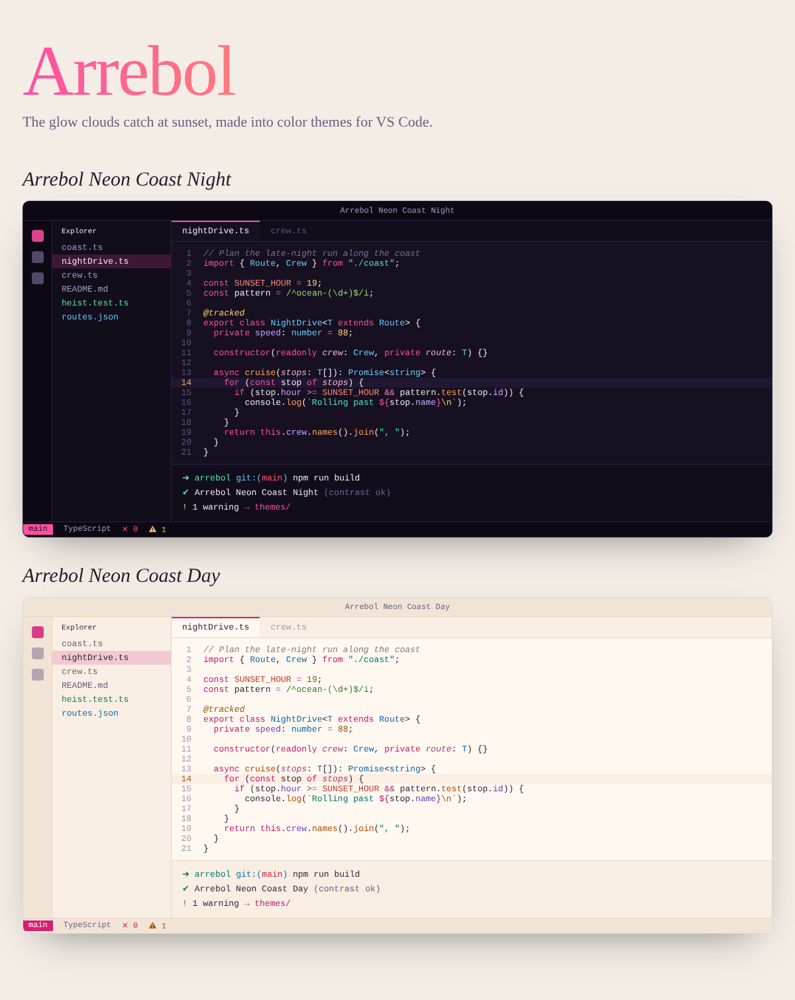

# Arrebol

*Arrebol* (Spanish): the rosy, fiery glow that clouds catch from the sun at dawn and dusk.

Arrebol is a growing collection of VS Code color themes inspired by vibrant aesthetics like **GTA VI**, Vice City, and Miami sunsets. Every theme comes in a dark and a light variant, and every palette is checked against WCAG contrast rules at build time, so the colors look good and stay readable through long sessions.



## Themes

| Collection | Variants | Mood |
| --- | --- | --- |
| Neon Coast | Night (dark), Day (light) | Inspired by GTA VI / Vice City vibes - neon signs, Miami sunsets, teal waters and palm trees on a tropical crime-caper coastline |

## Install

1. Open the Extensions view (`Ctrl+Shift+X` / `Cmd+Shift+X`).
2. Search for **Arrebol Themes** and install.
3. Open the theme picker (`Ctrl+K Ctrl+T` / `Cmd+K Cmd+T`) and choose an Arrebol theme.

To switch between dark and light automatically with your OS:

```jsonc
// settings.json
"window.autoDetectColorScheme": true,
"workbench.preferredDarkColorTheme": "Arrebol Neon Coast Night",
"workbench.preferredLightColorTheme": "Arrebol Neon Coast Day"
```

## Readability

The build fails unless each palette meets these minimums:

- Body text: 7:1 against the editor and the current line (WCAG AAA)
- Every syntax color: 4.5:1 against the editor and the current line (WCAG AA)
- Comments: 3:1 (quiet but readable)
- Errors, warnings, info and success colors: 4.5:1
- Text on buttons and badges: 4.5:1

## Development

Requires Node.js 18+. There are no runtime dependencies.

```bash
npm install          # only needed for packaging/publishing (installs vsce)
npm run build        # generate themes/, update package.json, write preview/index.html
npm run check        # run contrast checks only
```

Press `F5` in VS Code to open an Extension Development Host with the themes loaded.
Open `preview/index.html` in a browser to compare every variant side by side.

Adding a new theme takes two small files. See [CONTRIBUTING.md](CONTRIBUTING.md).

## Project layout

```
src/
  build.js                  build entry point
  lib/
    template.js             palette -> full VS Code theme (shared by all themes)
    contrast-check.js       WCAG rules every palette must pass
    preview.js              HTML preview generator
    color.js                color math helpers
  collections/
    neon-coast/
      collection.js         name, description, list of variants
      night.js              dark palette
      day.js                light palette
themes/                     generated theme JSON (committed, shipped in the extension)
preview/                    generated preview page
```


## License

MIT
